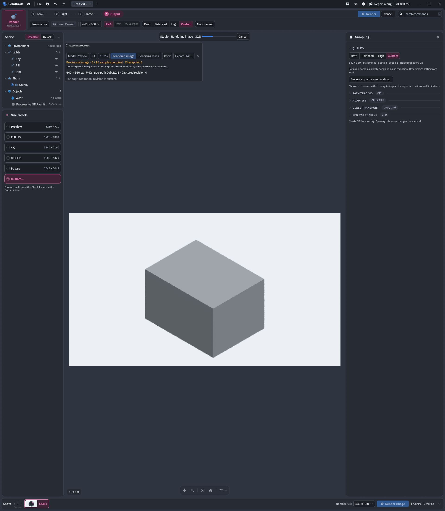
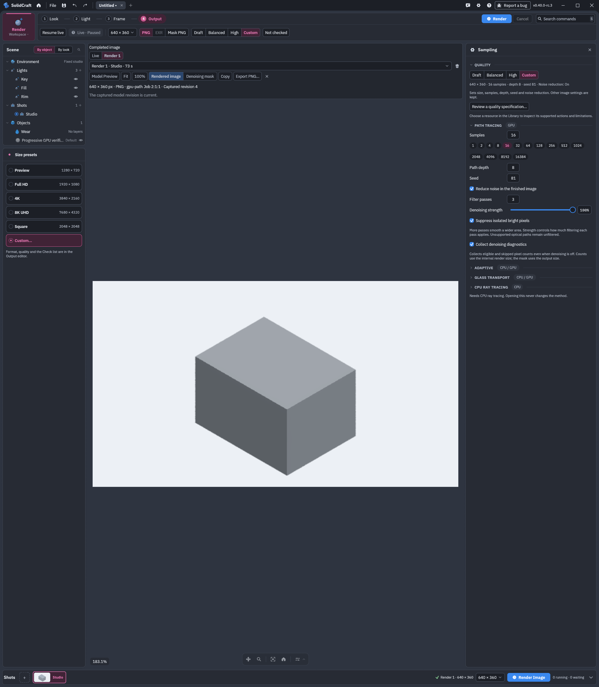
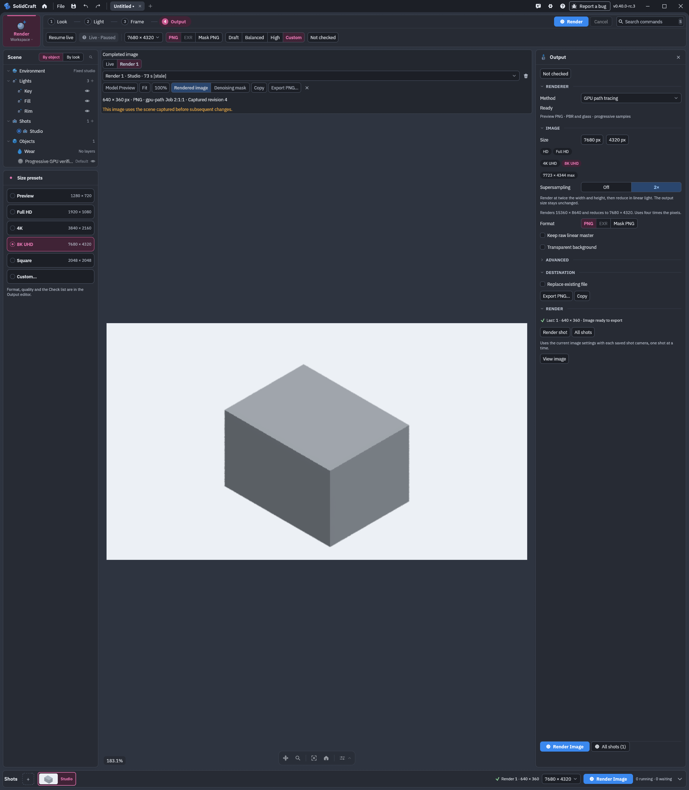
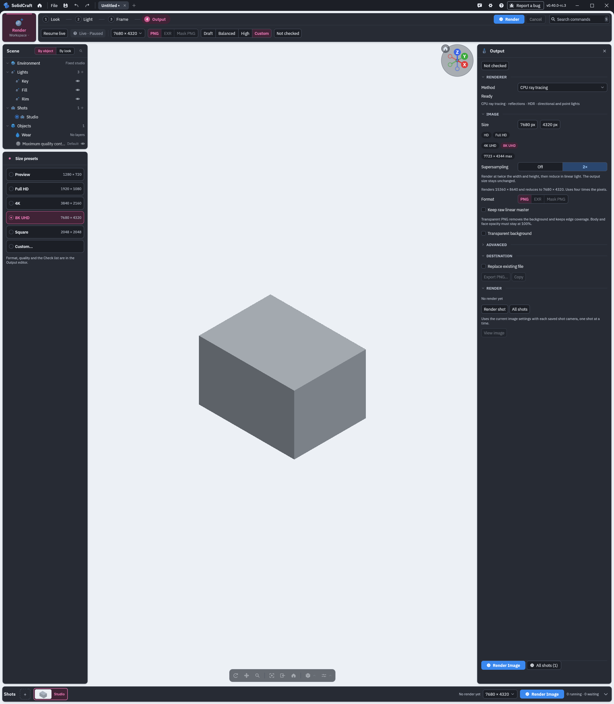
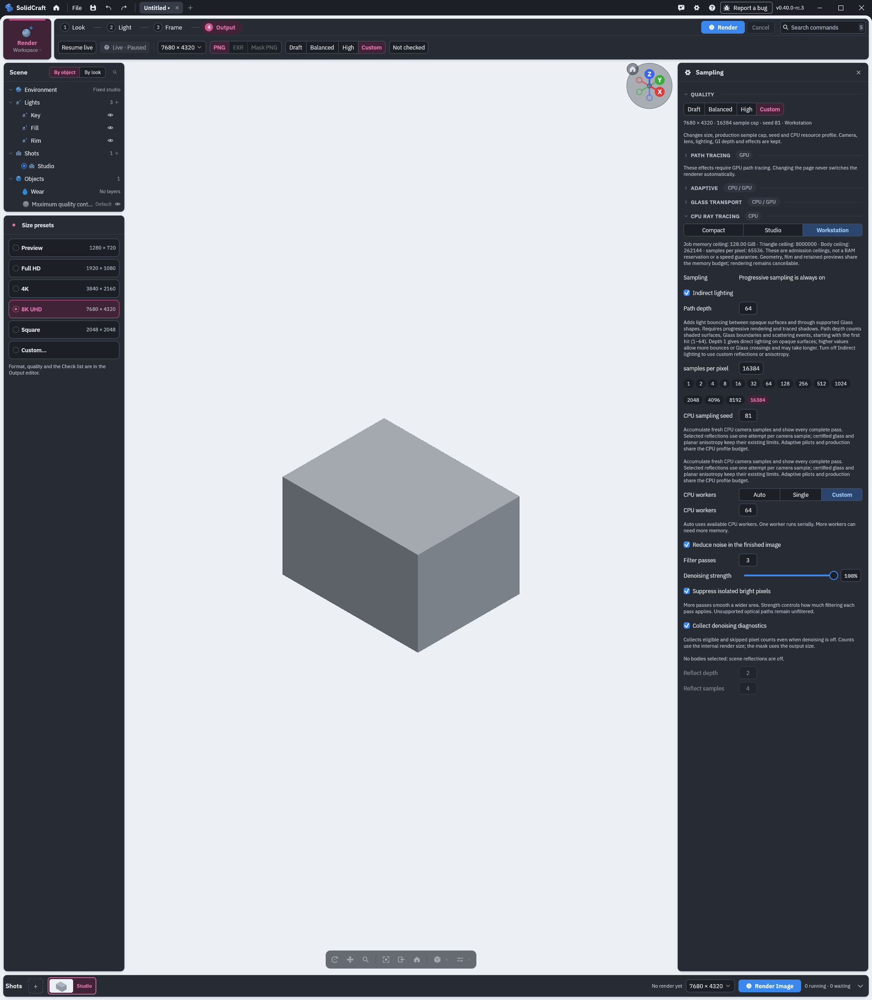

# PR #12546: GPU progressive display and render controls

Evidence for [SolidCraft PR #12546](https://github.com/tangency-labs/solidcraft/pull/12546), captured on 8 November 2026.

## Verified native GPU progression

The existing native app displayed completed GPU passes 1 through 15 and then the final image from a 640 × 360, 16-spp job. The actual adapter was **Vulkan · AMD Radeon 780M Graphics (RADV PHOENIX)**. The job was started with the real Render button. Denoising was enabled with three passes, full strength, bright-pixel suppression and diagnostics.

The [verification receipt](progressive-verification-receipt.json) records 15 distinct underlying preview PNG hashes, the displayed frame sequences, matching before/after screenshot identities, final-frame promotion, and zero preview-retention skips. The owned app stopped after capture.

| Pass 1 | Pass 5 | Final 16-spp image |
| --- | --- | --- |
| [Native screenshot](progressive-preview-001.png) | [Native screenshot](progressive-preview-005.png) | [Native screenshot](progressive-final.png) |

## GPU controls

After the small job completed, the native UI selected 7680 × 4320 output, X2 supersampling, 16,384 spp, path depth 64, and the denoise options shown below. Live remained paused, and no maximum-settings job was submitted. The image still visible in these screenshots is the previous 640 × 360 result, explicitly marked stale after the settings change.

X2 doubles each internal dimension to 15,360 × 8,640, then reduces the image to the selected 7680 × 4320 output. Denoising exposes an enable control, one to three passes, 0–100% strength, isolated-bright-pixel suppression and diagnostics. Bright-pixel suppression is selected in the capture; it is not the default.

## CPU controls

These earlier native CPU control captures used a GL/llvmpipe display, with Live paused and no CPU render started. They verify UI selections, persisted settings and layout. They show Workstation, Custom 64 workers, 8K UHD, X2, 16,384 spp, depth 64 and the selected denoise controls. See the [CPU capture receipt](cpu-controls-receipt.json).

## Source and validation scope

All captures use the candidate built from source tree `ae209221211b5f1e47e6c8a2a2639d7dd265ae84`.
GUI binary SHA-256: `81258dc2bb39bb322662bd3b333b39c947b052f3378a3c0798617885fe5121e8`.

At publication, the PR source head is `f5d3dbde867d6a1940a1de927256c4ceb57ee24a`, whose new UI sample selections still stop at 128. GPU progressive images already exist in that published code; the 16,384-spp changes shown here are awaiting completion of validation and a code push.

The [focused validation summary](focused-validation-summary.json) records 62 passing tests on the captured candidate, including hardware GPU fixtures with forced page boundaries and nonallocating maximum-request checks. The full repository run remains in progress with failures under review. No full 8K, X2, 16,384-spp image has been rendered.

This evidence branch retains the published PR code as its parent and adds only these evidence files. It does not publish the uncommitted candidate implementation to the PR source branch.

Screenshots are unmodified native captures. File hashes are listed in [SHA256SUMS](SHA256SUMS).
