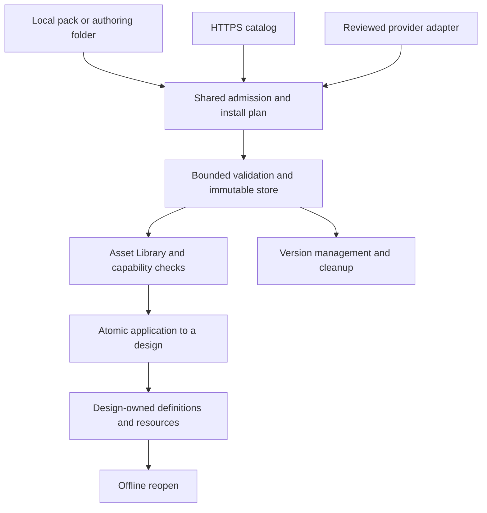
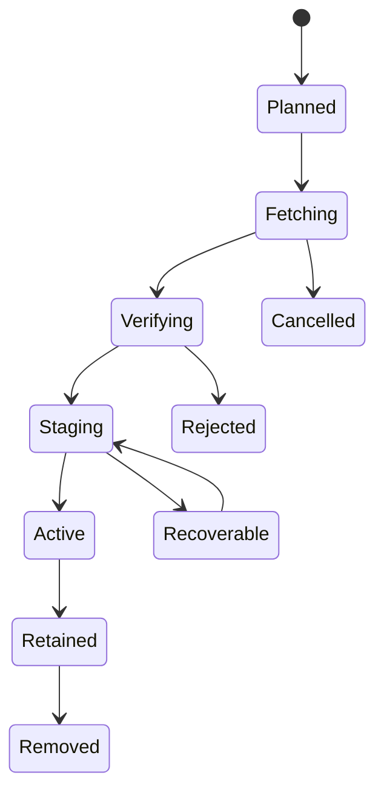

# Asset packs for SolidCraft: architecture spike

- **Status:** proposed architecture; ready for discussion, not an accepted format or an implemented installer.
- **Date:** 27 October 2026.
- **Requested destination:** 0xlillith's personal SolidCraft repository.
- **Scope:** reusable materials, appearances, finishes, lights, environments, backgrounds, studios, setups, mechanical parts and other declarative assets.

## Contents

- [Recommendation and decisions](#1-recommendation)
- [Repository evidence and scope](#2-evidence-baselines-and-scope)
- [Options considered](#3-options-considered)
- [Architecture and draft pack format](#4-architecture-and-separation-of-responsibilities)
- [Asset types and domain semantics](#6-asset-types-and-domain-semantics)
- [Interchange, identity and compatibility](#7-interchange-without-lowest-common-denominator-behavior)
- [Project portability](#9-project-portability-and-stable-behavior)
- [User experience](#10-user-experience)
- [Catalogs, installation and trust](#11-online-catalogs-and-predefined-sources)
- [Platform parity and migration](#14-native-browser-cli-and-mcp-parity)
- [Implementation sequence and acceptance](#17-implementation-sequence)
- [Risks, validation and limits](#19-risks-and-remaining-decisions)
- [Concrete pack example](#appendix-a-concrete-draft-pack-example)
- [Catalog example](#appendix-b-draft-static-catalog-example)
- [Project receipt example](#appendix-c-suggested-persisted-receipt-shape)
- [References](#references)

## 1. Recommendation

Build **one asset-pack system with a public ZIP + JSON format, typed assets, immutable content, a shared validator, and an Asset Library in the application**.

Users should be able to:

1. Browse a few curated sources already listed in SolidCraft.
2. Add their own compatible catalog URL, including a company or personal server.
3. Install a downloaded pack from disk, or import an authoring folder.
4. Preview and use its contents through the existing material, appearance, render and component workflows.
5. Keep embedded designs usable offline after a pack is updated, uninstalled or removed from its website; clearly identify assets whose rights or chosen storage mode require external content.

Use the proposed extension **`.scpack`**, while accepting ordinary `.zip` files with the same validated contents. A `.scpack` is a normal ZIP that can be inspected with ordinary archive tools. The extension is a proposal, not a registered external standard. Publish the JSON schemas, readable specification, examples and conformance fixtures before calling the SolidCraft format stable.

The architecture has three distinct contracts:

| Contract | Responsibility |
|---|---|
| **Pack** | A portable, inspectable collection of descriptors and payload files. |
| **Catalog/source** | Discovery, versions, download locations, sizes, integrity and source trust. |
| **Asset adapter** | Interpreting a supported asset type and applying it through SolidCraft's existing commands. |

An asset pack supplies **data**. It does not install Python scripts, native libraries, arbitrary shader source, shell hooks or a WebAssembly module. A separately governed executable-plugin system can provide new functionality later. The proposed asset system does not depend on that runtime existing first.

**Why this option:** it fits the repository's existing JSON, ZIP, hash, catalog and command foundations; remains practical for local files and static hosting; accommodates heterogeneous assets; and avoids tying ordinary material installation to a full executable-plugin ABI. These are engineering judgments grounded in the source review below, rather than benchmark results.

### Decisions recommended now

| Decision | Recommendation |
|---|---|
| Distribution format | Ordinary ZIP; Store and Deflate; ZIP64; UTF-8 JSON manifest at the root. |
| Authoring | The same files in a folder, with a publisher tool that validates and builds the ZIP. |
| Online discovery | Static HTTPS catalog with immutable release records; optional provider adapters later. |
| First dependency policy | Self-contained packs where practical; exact, source-bound external pins when needed. |
| Existing projects | Copy the selected definitions and permitted resource closure into the design; preserve exact receipts. |
| Updates | Install versions side by side. Updating a library does not update existing projects. |
| Compatibility | Separate package/schema versions from host features, importers and actual renderer capabilities. |
| Fasteners | Extend existing standard-part insertion and resizing with bounded families and variants. |
| Trust | Distinguish source identity, integrity, publisher claims and runtime validation. |
| UI | One Asset Library, contextual entry points, install-from-file and source management. |
| Interchange | Use glTF/GLB, STEP, MaterialX/OpenPBR and USD/USDZ where appropriate as payloads/adapters. |
| First implementation | A small local vertical slice, then reliable online distribution and additional type adapters. |

## 2. Evidence, baselines and scope

### 2.1 Pinned repositories inspected

Moving branch names are not reproducible evidence. This spike uses these pinned snapshots:

| Repository / line | Commit | What the review establishes |
|---|---|---|
| `0xlillith/solidcraft`, `main` | `807e367bdb03210dba188118fe000acd0a4b3725` | The source baseline for integration. Its workspace version is 0.21.0. |
| `0xlillith/solidcraft`, `lab/render-materials` | `5cc4d5fdcc08a4e3cba47b02e19a09e8cffacde6` | A separate WIP donor containing richer material/resource work; not proof of merged or validated main behavior. |
| `0xlillith/solidcraft-render-catalog`, `main` | `df356e2f277b9bd0d1cc62553dac8208f1aae958` | Current published authoring inventory, release metadata and documented acceptance boundaries. |

The application baseline is the user's fork, not a claim that this commit is the latest upstream release. All implementation observations below are source observations; this research did not compile or exercise the application. [R1] [R2] [R3]

### 2.2 Existing foundations and actual gaps

| Area | Present in the inspected source | Consequence for this design |
|---|---|---|
| Extensible-library proposal | A common material/appearance/component envelope, immutable revisions, provenance, project copies and bounded recipes are already proposed. Its initial transport is a directory plus JSON. | Extend that proposal's delivery and discovery; preserve its semantics. [R4] |
| Local scalar catalogs | `solidcraft-library/1`; 4 MiB JSON, 1,024 entries; appearance and density/look definitions. | Keep this format readable through an explicit legacy adapter. It is not the new mixed-media pack format. [R5] |
| Library commands | `library.inspect`, `library.export` and `library.apply`, with exact revisions and atomic application. | Reuse the workflow and command surface. [R6] |
| Appearance picker | A desktop local-library workflow; browser engine access to supplied VFS content has different limits. | Extend the picker; do not claim browser installation from a wasm build alone. [R7] |
| Plugins preferences | Scans `plugins/<id>/plugin.json` and records enabled/disabled state; explicitly does not load or execute folder contents. | Existing plugin UI is not an installer or runtime. [R8] |
| Executable-plugin design | A future sandboxed WASM/WIT host and parametric plugin model. | Coordinate names and navigation, while keeping data-pack admission independent. [R9] |
| Standard parts | Seven built-in families, insertion, resizing, component metadata and some placement/joint behavior. Cosmetic threads and bearing envelopes have explicit fidelity limits. | Add catalog-backed families to this path, rather than another part insertion engine. [R10] |
| Design container | ZIP-based `solidcraft-container/1` with bounded readers and digest-addressed blobs. | Factor suitable archive primitives and reuse design resource ownership; do not copy the entire installed pack into every design. [R11] |
| Current appearance model | Scalar color/opacity and an opt-in opaque metallic/roughness/IOR PBR subset. | A pack being readable does not make all texture, finish or lighting features usable. [R12] |
| Physical cards | Structured quantities, conditions and provenance, with limits on what validation proves. | Keep engineering properties separate from visual appearance and from simulation readiness. [R13] |

The existing library proposal is the semantic starting point. The new contribution is a more complete **distribution, lifecycle, UI and compatibility design** covering additional asset domains.

The upstream asset-browser request also describes local and web discovery, previews, metadata-aware insertion, source lists and offline reuse. This spike overlaps those needs and should be discussed alongside it, without claiming that the issue has accepted this design. [R14]

### 2.3 The catalog changes the scale of the problem

The catalog's global index reports **2,983 resource records**, spanning appearances, physical references and other resource kinds. This is not 2,983 distinct engineering materials. The historical original collection's release manifest describes **23,161 source files and 10,079,019,285 source bytes** across seven archives. Recent stages also separate browsing data, runtime maps and master maps. [R3] [R15] [R16]

Several stage records explicitly retain `native_acceptance: not_run` or pending visual qualification. The global README also says that no plugin/installer standard is established there. Consequently:

- Treat the authored catalog as content to adapt and qualify.
- Do not turn authoring inventory fields into a public runtime contract by accident.
- Support segmented delivery and bounded streaming.
- Preserve published release bytes and their provenance.
- Keep “published,” “structurally valid,” “usable in this host,” and “visually qualified” as separate states.

The global README/index and publication receipts supersede historical stage notes about earlier local-only or not-yet-uploaded work. Those older notes must not be silently interpreted as the current publication state. [R3] [R15]

### 2.4 What this spike does and does not deliver

It delivers the recommendation, alternatives, draft contracts, UI behavior, integration map, migration strategy, risks and future acceptance gates, plus a small format feasibility probe.

It does not implement the installer, renderer adapters, a public registry, a new geometry kernel, a full JSON Schema validator, browser storage integration or an executable-plugin host. The application, CI workflows and published asset releases are not modified by this report.

## 3. Options considered

The criteria are user effort, inspectability, hosting independence, native/browser portability, reliable updates, heterogeneous content, implementation cost and long-term extensibility.

| Option | Strengths | Weaknesses for this use | Decision |
|---|---|---|---|
| **Folder + JSON** | Excellent authoring and version-control experience; transparent structure. | Mutable files, incomplete copies and accidental edits make it a weak installed-state contract. | Keep as authoring/import input; snapshot on import. |
| **ZIP + JSON** | Familiar single file, offline transfer, readable metadata, static hosting, broad tool support. | Requires a well-defined profile, validator and lifecycle; ZIP alone supplies no asset semantics. | **Recommended distribution format.** |
| **TAR + Zstandard** | Good streaming/compression potential and publisher tooling. | Less convenient inspection for many desktop users; no semantic advantage over ZIP; another decoder profile. | Do not require it for version 1. Revisit only with measured benefits. |
| **SQLite or a custom binary database** | Efficient local indexing and queries. | Poor manual inspection/diffing; couples exchange to database structure; awkward merging and partial publication. | Suitable internal cache/index implementation, not the public pack format. |
| **Git / Git LFS as installer** | Strong author collaboration and text history. | Git/authentication setup, binary history and mutable refs complicate ordinary installation. | Publisher workflow only; published pack bytes are the client boundary. |
| **OCI artifacts** | Digest-addressed content and existing registry infrastructure; useful for organizations. | More client/authentication/operations complexity and a less familiar local-file UX. | Optional later transport for identical package semantics. [S4] |
| **glTF/GLB as the entire pack** | Strong display/scene interchange and useful previews. | Does not define this package lifecycle, physical-material cards, exact CAD families or source trust. | A representation inside packs. [S7] |
| **MaterialX/OpenPBR as the entire pack** | Useful shading interchange and material semantics. | Not a model for mechanical properties, component catalogs, installation or updates. | Optional, restricted appearance adapters. [S8] [S9] |
| **USD/USDZ as the entire pack** | Rich scene composition and variation. | USDZ has specific archive/payload constraints; it is not an unrestricted ZIP for arbitrary CAD descriptors and STEP payloads. | Optional scene interchange, not the universal envelope. [S10] |
| **Native/WASM executable bundles** | Can add new algorithms and host behavior. | Creates execution, sandbox, ABI and permission problems for content that needs no code. | Separate executable-plugin track. [R9] |

Blender's public extension documentation provides a useful packaging precedent: extension ZIPs can be indexed into a static `index.json` repository. This is a comparison of documented behavior, not adoption of Blender's implementation or a claim of format compatibility. [S5]

“Standardized” should mean a **published and versioned SolidCraft profile built from existing standards**, not that a newly named JSON format is already an industry standard. ZIP, JSON, JSON Schema and established payload formats solve different parts of the problem.

## 4. Architecture and separation of responsibilities



The library installation and design application are different transactions.

**Installation** adds immutable available content to a user library. It must not alter the open document, create geometry, change material assignments, move the camera or replace render settings.

**Application** selects an asset, resolves its exact dependencies and capabilities, copies its required state into the document, and performs one undoable edit. This uses existing engine operations and refuses unsupported transformations.

**Authoring** is also separate. Generators that create source textures or catalogs may be normal development tools under the repository's authoring policy. Installing their outputs must not execute those tools.

### 4.1 Reuse existing layers

| Location | Proposed responsibility |
|---|---|
| `crates/io` | Envelope/catalog parsing, bounded archive primitives, inventory validation, legacy readers and import/export contracts. |
| `crates/doc` | Definitions actually selected by a design, immutable resource references, source receipts, parameters and saved setup instances. |
| `crates/engine` | Inspect/plan/install job coordination, compatibility decisions, document application, explicit updates and atomic transactions. |
| `crates/render` and existing adapters | Interpretation of supported optical, light and environment data; backend-specific capability results. |
| `crates/ui-egui` | Browse/search/detail/install/source UI; thin command dispatch through existing containers and theme tokens. |
| Native and web hosts | HTTP, credential storage, filesystem/OPFS integration, asynchronous jobs and platform-specific storage operations. |

Start with modules in the current crates. Create a standalone asset-core crate only if dependency direction or real reuse justifies it; do not add a new framework merely for naming symmetry.

Keep filesystem/network interfaces narrow and injectable. Do not make `doc` depend on the pack installer or network. Keep installed-library metadata and download progress out of document undo history. Existing VFS/path scopes continue to govern CLI, MCP and control-channel access.

The application already uses `serde`, `serde_json`, `schemars`, `sha2`, `semver` and `zip`. That reduces foundational work, but does not establish that the current archive or schema code is already an adequate public asset validator. [R1] [R11]

### 4.2 Proposed command family

These names are illustrative and **do not currently exist**:

| Proposed command | Result |
|---|---|
| `library.pack.inspect` | Validate a selected input and return inventory, compatibility and provenance. |
| `library.pack.plan` | Return exact downloads, dependencies, storage requirements and warnings. |
| `library.pack.install` | Start the previously reviewed installation plan; return a job handle. |
| `library.pack.list` | Installed immutable versions, states and storage use. |
| `library.pack.update_plan` | Compare available releases without modifying designs. |
| `library.pack.rollback` / `library.pack.remove` | Change availability for future use, respecting pins and known dependents. |
| `library.source.list` / `add` / `remove` | Manage explicitly configured catalogs. |
| `library.asset.inspect` | Inspect a resolved typed asset and backend support. |
| `library.asset.apply` | Apply a resolved asset through its supported adapter in one document transaction. |

Preserve existing `library.inspect/export/apply` behavior for scalar libraries. New commands should not reinterpret old JSON or silently widen its permissions. Programmatic calls take explicit arguments and never open dialogs; the UI owns pickers. Final command naming should be reviewed with the existing library and plugin owners. [R6] [R17]

## 5. Draft pack format

### 5.1 ZIP profile

Proposed external filename: `industrial-finishes-1.2.0.scpack`.

| Path | Purpose |
|---|---|
| `pack.json` | Required root manifest; the pack's identity, assets, requirements and complete file inventory. |
| `assets/<id>.json` | Typed descriptors for individual assets. |
| `payloads/...` | Textures, HDR images, supported geometry and other inert content. |
| `previews/...` | Optional bounded raster previews; display-only. |
| `licenses/...` | Original applicable license/notice texts. |
| `sources/...` | Optional provenance records and source locators; not arbitrary websites to fetch. |
| `README.md` | Optional user documentation, rendered as restricted text/Markdown. |

The ZIP profile should support **Store and Deflate**, plus **ZIP64** for large files/collections. Reject encryption, self-extracting archives and multi-volume ZIPs. Existing separately published catalog ZIPs are separate archives, not ZIP “volumes.” The PKWARE specification is the archive reference; SolidCraft defines the narrower accepted profile. [S1]

The existing design-container reader has a narrower profile that rejects ZIP64. Pack admission therefore needs an explicitly extended bounded reader; the current design reader cannot simply be reused unchanged. [R11]

The canonical publisher writes `pack.json` first, with deterministic entry order, timestamps and metadata. A consumer must still validate the entire archive structure and must not trust an early manifest to override a later conflicting entry.

Hashing a published artifact uses its **exact bytes**. Reproducible packaging additionally requires a pinned compression implementation/settings; equal logical files do not imply byte-identical Deflate output across tools. Repacking a release changes its archive digest and must be published as a new release under the immutability policy.

Use portable, relative paths. Reject absolute paths, drive prefixes, backslashes, traversal, symbolic links, hard links, special files, Windows device names, alternate data streams, trailing-dot/space aliases and case-fold collisions. Restrict path syntax to a documented portable subset; localized names belong in metadata. Canonical writers omit directory entries; readers may accept safe empty directory entries without treating them as payload files.

Recognize the contents, not just the filename extension. A generic downloaded ZIP without a valid root manifest is not an asset pack. An authoring tool can explain the missing manifest or offer an explicit supported legacy import.

### 5.2 Manifest responsibilities

| Field group | Meaning |
|---|---|
| `format` | Proposed marker `solidcraft-asset-pack/1`; independent of the design and scalar-library formats. |
| `id`, `version` | Stable namespaced package identity and SemVer release version. |
| `name`, descriptions, tags | Human discovery metadata; never identity. |
| `publisher` | Declared author/publisher metadata; not authentication by itself. |
| `license_expression`, `license_files` | Package defaults, with explicit per-asset/file exceptions. |
| `requires` | Host asset-API requirement; asset-specific capabilities remain local to entries. |
| `dependencies` | Exact package pins with source bindings or portable logical aliases. |
| `assets` | Stable local IDs, kinds, type-schema versions, descriptors and capabilities. |
| `files` | Inventory of all regular members except `pack.json`: exact bytes and SHA-256. |
| `extensions` | Namespaced, bounded metadata; required semantic extensions declared separately. |

Every referenced payload must be inventoried. In version 1 the only control-member exception is exactly `pack.json`; every other regular member must be declared. The manifest does **not** hash itself. The catalog records the SHA-256 of the complete archive, which covers the manifest and inventory without a circular hash. Detached distribution metadata can authenticate that archive digest.

For local unsigned imports, hashing still detects corruption and establishes exact identity; it does not prove who authored the file.

Appendix A contains a complete small manifest and three descriptors used in the format probe. The example capability names and schemas are proposed, not supported API names in the inspected release.

### 5.3 Schema and semantic validation

Publish JSON Schema **Draft 2020-12** for the envelope, repository index, receipts and each stable asset type. Bundle trusted schemas with SolidCraft and the authoring CLI. Do not fetch arbitrary remote `$ref` values or schema URLs from untrusted packs during validation. [S2]

Schema checks cover shape, required fields, numeric ranges and permitted vocabularies. A separate semantic pass verifies:

- Inventory sizes/hashes and complete references.
- Duplicate IDs and portable path uniqueness.
- Correct units, finite values, texture roles and coordinate transforms.
- Dependency and reference graphs, including selected optional branches.
- Declared capabilities against actual adapter/backend support.
- Bounds on geometry, decoded images, graph expansion and work.
- Licensing/provenance completeness, while preserving the distinction between a declaration and verified permission.

Reject duplicate JSON object keys before typed deserialization, invalid UTF-8, nonfinite numbers, excessive nesting and oversized strings. JSON parsing success alone is not sufficient.

Core semantic fields are strict. Unknown required fields/extensions cannot be ignored. Optional descriptive metadata can evolve additively in a bounded `extensions` namespace. New behavior that changes interpretation needs a new type version or a required capability.

An unsupported outer format major prevents installation. An unknown optional asset type may be retained opaquely only after envelope, path and inventory validation, and displayed as **Unavailable in this version**. It cannot satisfy any reference required by a usable asset or be applied. Preserving an unknown descriptor never bypasses the file-type admission policy. Any integrity failure, unsafe structure or malformed known descriptor rejects the pack rather than producing an unexplained partial installation.

## 6. Asset types and domain semantics

Use one envelope and a registry of typed adapters. Do not force every asset into a “material” object or a generic executable plugin.

| Proposed kind | Data and intended use | Important boundary |
|---|---|---|
| `physical_material` | Grade/condition, quantities, units, sources and uncertainty. | Separate from optical appearance and simulation certification. |
| `appearance` | Supported shading parameters and texture-set references. | Does not silently change density, strength or geometry. |
| `texture_set` | Images, channel roles, color spaces, normal convention, physical scale and tiling. | Do not infer semantics from filenames. |
| `finish` | Ordered appearance treatment, masks and editable parameters. | Visual coating/weathering is separate from physical coating mass or thickness. |
| `light` | Emitter type, dimensions, color and declared intensity units. | Electrical watts, radiometric power and photometric intensity are not interchangeable. |
| `photometric_profile` | Supported IES data and measurement/orientation metadata. | Requires an implemented, bounded loader. |
| `environment` | HDR illumination/reflection resource or supported procedural sky. | Its lighting role and camera visibility are independent. |
| `backdrop` | Backplate, solid/gradient background, or supported studio geometry. | A visible image need not illuminate the scene. |
| `studio` | Lights/environment/backdrop references and placement/scaling policy. | Owns its rig elements, not the user's entire scene. |
| `scene_setup` | Studio, camera, render/post settings and explicit application scopes. | No arbitrary model or application-preference mutations. |
| `render_preset` | Quality, output and tone-map values supported by the selected backend. | No arbitrary filesystem destinations, commands or remote jobs. |
| `component` | Native/exact/display representations, insertion datums and BOM metadata. | A preview mesh is not authoritative exact geometry. |
| `component_family` | Finite size tables or constrained parameters for a trusted host generator. | No downloaded generator code or arbitrary command recipe. |
| `assembly_template` | Referenced parts, transforms and supported connection/joint data. | Bounded dependency closure and one insertion transaction. |

Later kinds can include decals, LUTs, lens profiles, drawing symbols/styles, cross-section profiles, fixtures, woodworking stock and simulation property references. Their envelopes can be reserved without claiming usable adapters.

The UI need not expose this entire taxonomy as separate navigation sections. **Materials**, **Finishes**, **Lighting**, **Studios & backgrounds** and **Parts & assemblies** are practical user-facing groups.

### 6.1 Physical materials and appearances

A material card should preserve the exact material identity and state: alloy grade, temper, species, moisture, polymer product, print orientation, cure state or other relevant qualifiers.

Each physical quantity should support:

| Item | Example of meaning |
|---|---|
| Quantity and value/range | Density, elastic modulus, conductivity or strength, without changing the quantity's definition. |
| Unit | Explicit SI or a supported original unit with a documented conversion. |
| Conditions | Temperature, moisture, direction, process, heat treatment, specimen preparation. |
| Evidence status | Measured, manufacturer-reported, reference, estimated or unknown. |
| Source | Publication/product identifier, edition/date, locator and retrieval record. |
| Uncertainty/spread | Preserve its stated interpretation; do not invent a confidence interval. |

Unknown remains absent/null; it must not become zero. A physical property copied from a source is not automatically a design allowable, solver input or product certificate. The catalog's existing physical profiles already retain source values, SI conversions and conditions, which should survive migration. [R13] [R18]

Keep both records linked in the interface: **Apply appearance** and **Assign physical material** are distinct actions. “Apply both” can be explicit when a pack defines a meaningful association.

SolidCraft geometry uses millimetres/radians and Z-up; current scalar material density is represented in g/cm³. A new physical descriptor may store explicit SI quantities, but adapters must convert deliberately and preserve the original units. Never infer units from magnitude. [R4] [R5] [R17]

Visual grain/mapping axes, mechanical orthotropic axes and stock/nesting orientation are independent. A user can align them deliberately; moving a texture must not rotate a mechanical tensor or alter the manufacturing stock definition.

### 6.2 Finishes, weathering and postprocessing

Represent finishes as an ordered, editable stack referencing trusted host operations. Examples include brushed/satin treatment, clear coating, paint, oxidation, scratches, edge wear and surface dust.

A finish instance records its parameters, mask semantics, coordinate space and stable random seed where applicable. The host defines blend order and supported channels. Store enough to reproduce the selected look rather than baking an unexplained final color into the material.

Separate these domains:

- **Surface finish:** affects a material/appearance on a body or stable face binding.
- **Atmosphere:** suspended dust or fog affects the scene volume and requires a different renderer capability.
- **Lens/post effect:** flare, bloom, vignette, color grading or a LUT affects the image pipeline.
- **Physical process/coating:** changes engineering geometry/mass only through a separately supported, explicit operation.

A dust layer is not evidence of airborne scattering support. A clearcoat parameter is not a measured coating thickness. Unsupported layers must be visible before applying or rendering; never silently drop them for a final export.

Store stable body/face/component references where the document model supports them. Name/index-only runtime bindings are insufficient for persistent finishes. The inspected donor's texture documentation explicitly describes transient bindings, so durable mapping remains actual work. [R19]

### 6.3 Lights, environments and backgrounds

Light descriptors need a declared intensity model, not an ambiguous `power` number. For example, glTF's punctual-light contract distinguishes candela for point/spot lights and lux for directional lights. Conversion from lumens requires a distribution model. A host with only artistic intensity units must label an approximation instead of claiming photometric equivalence. [S11]

A studio should independently express:

| Role | Example |
|---|---|
| Illumination | HDR environment or a procedural sky used to light the product. |
| Reflections | The environment seen by reflective surfaces. |
| Camera background | A separate gradient, photo/backplate or transparent output. |
| Ground | Shadow receiver or geometry with an explicit stage role. |
| Light rig | Named owned light instances and transforms. |

This permits an HDR-lit product against a clean white backplate, a dark camera background with visible reflections, or a transparent final image. A tone-mapped JPEG preview is not a substitute for an HDR lighting resource.

World orientation, environment rotation, camera pose and texture projection are explicit. Avoid duplicated suns when a sky/HDRI setup already owns a dominant emitter.

Studios need both **absolute** and **subject-relative** placement policies. Scaling a rig to a small screw or a vehicle must define what happens to emitter size, position and intensity. Relative rigs should use a stable subject frame/bounds at application time and persist the resolved result; camera motion must not cause the lights to rearrange unpredictably.

### 6.4 Studios and complete setups

The proposed interaction is:

1. Resolve the studio/setup and its dependencies.
2. Check the current document, renderer and device.
3. Preview changes in temporary state.
4. Show scopes: lights, environment, background, camera, render settings, postprocessing, and optional material assignments.
5. Apply selected scopes in one undoable transaction.

Use an instance ID and owned-object IDs for the rig. Replacing a studio edits only its owned elements. Applying twice must not silently duplicate lights or remove unrelated user lights. Cancellation must leave the document and undo history unchanged.

A setup should never contain arbitrary engine command IDs, file-output paths, shell actions, account changes or application preferences. It contains typed declarative intent, interpreted by a trusted host adapter.

### 6.5 Mechanical parts and McMaster-style browsing

Users should browse **families and valid variants**, not thousands of unrelated mesh filenames.

For a fastener, the descriptor should retain:

| Group | Fields |
|---|---|
| Identity | Family ID/revision, designation, standard and edition when sourced. |
| Thread | System, nominal diameter, pitch, handedness and thread form. |
| Dimensions | Length and its measurement convention; head/drive dimensions where supported. |
| Variant constraints | Allowed diameter/length/grade/finish combinations and provenance. |
| Placement | Insertion origin, axis, seating plane and optional connection frames. |
| Fidelity | Cosmetic, simplified or detailed threads; envelope versus detailed bearing/model. |
| Commerce | Supplier/manufacturer name, SKU and product link, independent from asset identity. |
| BOM | Description, quantity unit and exact selected variant. |
| Geometry | Authoritative representation and generator/importer provenance. |

Start with finite reviewed variant tables and existing host generators. The inspected `parts.library`, `parts.insert` and `parts.resize` paths already implement seven useful families. Pack support should preserve component identity, placement and supported joints when changing a size. [R10]

Do not present every free parameter combination as a purchasable standard item. “Generic parametric screw” and “specific supplier product” are different records.

A family can refer to a versioned **built-in** generator with bounded numeric parameters. A broader recipe language, if needed later, must have an allowlisted instruction set, bounded loops/expansion and no file/network access. A missing generator disables generation; it must not trigger automatic installation of executable code.

Preserve generator ID/version, exact parameter values and a usable snapshot. Geometry-cache keys include generator/kernel compatibility and tessellation settings. An unavailable generator can leave an existing placed part viewable, while parametric editing is explicitly unavailable.

**McMaster is a browsing/use-case reference, not a free source of redistributable models.** Its terms inspected for this spike restrict redistribution of CAD models and incorporated drawings/prototypes. Therefore the default public starter pack should use independently authored or expressly licensed families, with supplier links where appropriate. Supplier-specific imports need their applicable permission/provenance retained; embedding them in a portable shared design cannot be assumed permitted. [S12]

This is a content-admission constraint, not a proposal to scrape a supplier catalog. Kernel work is currently paused under the repository guidance, so the first pack implementation should use existing part-generation/import interfaces and coordinate geometry-dependent extensions separately. [R23]

## 7. Interchange without lowest-common-denominator behavior

| Representation | Recommended role | What it must not imply |
|---|---|---|
| Native `.solidcraft` subset/snapshot | Editable components and saved host semantics, subject to document compatibility. | Every current/future design can be imported as an unrestricted template. |
| STEP | Supported exact CAD exchange and assembly information. | Reconstruction of original native feature history or universal importer coverage. [S13] |
| GLB/glTF | Display meshes, previews and supported PBR interchange. | Exact B-rep topology, engineering certification or native texture acceptance. [S7] |
| MaterialX | Optional restricted shading graph interchange. | Arbitrary graph/source execution or support for every standard node. [S8] |
| OpenPBR | A useful surface-shading semantic reference/adapter target. | Physical-material properties or complete renderer implementation. [S9] |
| USD/USDZ | Optional complex scene exchange. | Universal package lifecycle or arbitrary SolidCraft payload support. [S10] |
| PNG/JPEG, HDR/EXR, IES, LUT files | Typed payloads when a concrete adapter supports them. | Support merely because a decoder extension or MIME type is recognized. |

Each component identifies authoritative, display and thumbnail representations. Never compute a claimed exact mass or geometric tolerance from a low-resolution preview while implying it came from the exact solid.

glTF uses metres and Y-up, while the native descriptor convention here is millimetres and Z-up. Convert once at the importer boundary, retaining the transform and checking dimensions. Do not “override” intrinsic format units in metadata and then convert twice. [S7] [R17]

For textures, retain role, channel packing, color space, normal-map convention, physical extent, wrap mode and whether the image is a finite patch or a seamless tile. Existing wood assets explicitly describe finite board patches; converting them into automatically repeated tiles would change their intended use. [R20]

MaterialX deserves a specific boundary: its specification includes external references/XInclude and implementation source mechanisms. A data-only adapter must confine references to admitted payloads, reject network/entity resolution and custom source implementations, and allow only supported bounded nodes. Do not pass untrusted MaterialX directly to an unrestricted shader compiler. [S8]

Conversions should return an explicit result:

- **Supported:** the selected host contract preserves the supported semantics.
- **Approximate:** named features change, with a reviewable fallback.
- **Preview only:** useful for browsing, unavailable for authoritative application.
- **Unsupported:** a required interpretation is missing.

Even supported content does not promise bit-identical rendering across different GPUs, drivers or renderer versions. Reproducibility records should retain backend/version, color management, selected representations and relevant seeds/settings when that precision matters.

## 8. Identity, versions, compatibility and dependencies

### 8.1 Resolve identities, not names

Use a complete resolution identity:

`(configured source identity, package ID, exact version, archive SHA-256, asset ID)`

Source identity is assigned/bound by the host when a source is configured. The manifest's publisher name, reverse-DNS ID or catalog ID is a claim; none authenticates itself.

Portable receipts must not store only a machine-local source-table row ID. They retain a serializable authority/origin identity, approved locator information and the verified trust-root/rotation context where present. Another machine explicitly binds that identity to its local configuration. An approved mirror can serve the same digest under the same verified authority; an origin migration needs signed trust continuity or explicit source rebinding. A new URL or copied catalog ID cannot silently inherit trust. Unsigned/local origins remain identified as such, with exact content pins and no invented publisher authentication.

A display name can change without breaking references. An existing catalog ID should survive migration as an origin/alias record, rather than being replaced with a label-derived slug. Two sources advertising the same package ID must remain distinguishable.

For local imports, the host records local provenance and exact bytes. If the digest matches a package already installed from a verified source, the bytes can be deduplicated; importing a file must not silently promote its publisher trust.

### 8.2 Keep version dimensions separate

| Version dimension | Answers |
|---|---|
| Pack envelope major | Can the application understand the package structure safely? |
| Per-type schema version | Can the relevant adapter interpret this descriptor? |
| Host asset API/capability version | Can the application perform the requested operation? |
| Package SemVer | Which published content release was selected? |
| Application build/version | Which implementation and fixes are present? |
| Renderer/device/format capabilities | Can this specific execution path produce the requested result? |

SemVer supplies a useful release policy, including immutable published versions. It does not by itself guarantee compatible rendering or physics. [S3]

A package release must not be overwritten with different bytes. A repeated source/package/version with a different digest is a conflict, not a routine update. An intentional replacement requires a new version. Never use build metadata as a hidden channel for conflicting same-version payloads.

The content release's public contract comprises stable asset IDs, supported parameters and published descriptor semantics. Removing an asset or changing incompatible semantics requires a major release; compatible additions are minor. Corrections to values or resources require a new version and explicit release notes even when categorized as a patch. A corrected density or screw dimension must be highlighted as consequential, never treated as permission to change existing designs. All existing instances remain pinned regardless of the version category.

### 8.3 Dependency policy

Start with **exact pins**, not a general version solver.

A dependency entry names a logical binding, package ID, exact version and expected archive digest. A configured-source binding or verified same-source rule determines where it can be fetched. It must never search every enabled source for a matching name or silently add a source specified by the package.

Publisher tooling may use ranges during authoring, but it emits exact resolved pins for distribution. Projects record the selected closure, including optional representation packs actually used.

Resolve the whole graph before activation or design edits. Different versions of the same package are valid distinct nodes and can coexist. A conflict means different digests for the same immutable source/package/version or an inconsistent binding of the same dependency alias; aliases are scoped to their containing package node. Reject those conflicts, missing required entries, cycles and excessive depth/count. Optional dependencies need an explicit role and fallback; “optional” must not mean silently ignore a missing resource used by the selected asset.

For maximum portability, a transfer bundle may carry dependency archives as separately identified artifacts under an explicit bundle format. That should be a later, independently versioned feature; version 1 does not recursively install whatever ZIPs happen to be inside a pack.

### 8.4 Capability decisions are operation-specific

Do not reduce compatibility to one green tick.

| Question | Possible answer |
|---|---|
| Can the envelope be admitted? | Yes; structure/inventory are valid. |
| Can this asset's metadata be shown? | Yes; descriptor or safe envelope summary is understood. |
| Can it be applied to the current design? | No; required finish mapping is unavailable. |
| Can it be rendered on the selected backend? | Preview only; no volume scattering support. |
| Can it be saved/reopened without loss? | No; the document format cannot yet preserve the resource binding. |
| Can it be exported in the chosen format? | Yes with explicitly listed losses, or refusal. |

Compute compatibility against both declared requirements and requirements derived from the actual descriptor. A publisher cannot bypass a check by omitting a capability flag.

Use the intersection of pack policy, decoder, document-container, backend and device limits. A large pack being installable does not raise a current HDR consumer's pixel or byte limit.

## 9. Project portability and stable behavior

### 9.1 Embed the selected closure

When applying an asset, persist:

- Source/package/asset identity, exact version and digests.
- The selected typed definition and parameters.
- Required payload bytes and transitive dependencies, where rights permit.
- Source/license/attribution records.
- Chosen representation, importer/converter version and any approximation decision.
- Stable target bindings and setup-instance ownership.

Reuse the design container's resource deduplication. Keep immutable blobs shared with undo snapshots; do not repeatedly base64-copy a large HDR image into each undo state.

Copy only what the design actually uses. Selecting one finish from a 2 GB collection should not embed 2 GB. Preflight the resulting document/save limits before applying, preserving the previous document if the operation cannot be saved.

A lock/reference receipt is useful provenance, but it is not a replacement for actual bytes. A digest alone cannot make an unavailable remote file appear offline.

### 9.2 Portability modes

| Mode | Behavior and honest guarantee |
|---|---|
| **Embedded** | Selected permitted content travels with the design. This is the preferred default. |
| **Pinned external** | Exact references remain external; reopening depends on an available matching cache/package. Clearly not fully portable. |
| **Private/restricted external** | The user retains applicable content separately; sharing/export warns about unresolved or restricted content. No automatic public re-embedding. |

A license string or `redistributable: true` assertion is not proof of permission. Prefer clearly reusable content for predefined starter packs. Preserve restrictions and offer explicit replacement/export choices instead of silently stripping content or making unsupported portability promises. SPDX identifiers/expressions are useful for consistent declarations. [S14]

### 9.3 Updates and edits

Installing version 1.3 must not change a design that used 1.2. Existing document copies and references remain stable until the user chooses **Update assets in this project…**.

That operation shows a semantic diff: parameter defaults, material quantities/conditions, texture resources, generator changes, topology-sensitive bindings and setup changes. It is atomic and undoable. Failed remapping retains the previous state.

Edits to an installed asset create a document copy or a user-authored derivative with explicit provenance. They never mutate immutable package files in place.

Uninstalling a package removes library availability for new use. Embedded projects remain usable. External pins and known dependents require a clear warning; the application cannot honestly claim to know every project on disconnected drives or other machines.

### 9.4 Document migration

New durable receipts, resource bindings or setup-instance fields require the repository's normal design-format migration procedure. Add the appropriate pending migration file when implementation occurs; do not overload `solidcraft-library/1` or silently reinterpret name-based assignments. The report itself makes no design-format change. [R17]

## 10. User experience

### 10.1 Where it belongs

Expose **Asset Library…** through the application's library/management navigation, with contextual **Get more…** actions in Appearance, physical Materials, Render and Standard Parts. A named Manage entry is a proposed placement; the verified existing local-library route is Appearance → Local library. [R7]

Use a practical main navigation:

| View | What the user sees |
|---|---|
| **Browse** | Search, categories, source filters, compatible items and previews. |
| **Installed** | Installed packs/versions, disk use, update/repair/remove actions. |
| **Sources** | Predefined catalogs, user URLs, local authoring imports and connection status. |
| **Favorites / Recent** | Frequently used assets and sources. This can share the existing library surface. |

Keep **Install from file…** and drag-and-drop visible. A data pack appears here, while executable extensions remain in the separately identified Plugins area.

Do not expose SHA-256 strings, WIT versions, internal crate names or JSON paths in the normal browsing flow. Put advanced provenance and diagnostics in an expandable Details section.

### 10.2 Pack and asset details

A card should show a useful image, name, category and short capability/status summary. A detail sheet adds:

- What the pack contains and how many assets of each user-facing category.
- Download size, installed size and optional quality tiers.
- Publisher, source and license summary.
- “Ready to use,” “Some items need additional support,” or a specific incompatibility.
- Installed version and available update.
- A clear primary action: **Install**, **Use**, **Insert**, or **Apply**.

Show source trust and content usability separately. “Signature verified” must not imply that geometry, optics or engineering properties are certified.

The UI can display a mixed pack as “12 usable assets; 3 require the photometric importer,” with the unavailable items still inspectable. These numbers are an illustrative message, not a measured pack.

### 10.3 Installing from a predefined source

1. Open the Asset Library and choose a category.
2. Browse cached/lazily fetched metadata and previews.
3. Select a pack or a supported quality tier.
4. Review a short install summary, including dependencies and total space.
5. Install with progress and cancellation.
6. Use the newly available asset through the normal contextual operation.

For ordinary trusted small packs, the summary can be part of the detail sheet rather than another modal confirmation. Additional prompts are reserved for material choices such as new sources, large downloads, explicit unsigned-source policy or replacing project content.

### 10.4 Adding a user source

**Add source…** accepts a compatible HTTPS catalog URL. The application retrieves bounded metadata, shows the actual origin/name/trust status and asks the user to save that source.

A generic website with no compatible catalog is not silently scraped. Offer a useful explanation and an optional browser shortcut for manual download. “Web source” can mean three different things:

| Source form | Supported interaction |
|---|---|
| Native SolidCraft catalog | Direct search/download/install. |
| Reviewed provider adapter | The provider API is normalized into the same internal asset/receipt model. |
| Website shortcut | Opens the website in the user's browser; downloaded supported files are imported explicitly. |

This distinction allows predefined useful sites without pretending every website implements the pack protocol.

Credentials for private sources belong in OS/application credential storage. Do not put tokens, signed temporary URLs or private credentials in pack manifests, project receipts or shared links.

### 10.5 Installing from disk and authoring folders

A selected `.scpack` or compatible `.zip` gets the same inspection and installation plan as an online pack. Self-contained packs and already-cached dependency closures install without an account or internet connection. Missing external pins produce an explicit download plan from configured sources, or an actionable offline failure. Merely opening a local pack must not trigger hidden network requests.

A directory import snapshots the files into immutable installed content. A separate developer mode can preview an authoring folder live, clearly marked **Mutable authoring source**. Designs still capture exact bytes/definitions when applying. Do not make users depend on a watched mutable folder for reproducibility.

An OS drag-and-drop action should distinguish a pack installation from importing an individual model or texture. It must not execute files inside the archive.

### 10.6 Applying content

- **Material:** select the target and explicitly apply physical properties, appearance or both.
- **Finish:** preview/reorder layers; confirm affected bodies/faces; apply once.
- **Light/studio:** preview the rig and affected scopes; retain unrelated scene elements.
- **Background:** choose camera visibility independently from environment lighting.
- **Part family:** filter valid sizes, choose a representation, then place using the existing insertion tools.
- **Setup:** review camera/environment/lights/render/post scopes before applying.

A preview is disposable. **Apply** is one document edit, **Cancel** is none, and an additional **OK** must not create duplicate undo steps.

### 10.7 Useful failures

| Situation | Suggested user-facing message |
|---|---|
| Missing capability | “This studio needs IES lights. You can browse it, but this version cannot apply it.” |
| Invalid download | “The download does not match the published file. Retry or choose another source.” |
| Insufficient space | “There is not enough space for this quality tier. Choose a smaller version or free space.” |
| Unsupported background mode | “The selected renderer cannot use this backplate. Keep the current background or choose another renderer.” |
| Stale project version | “This project uses 1.2.0. Version 1.3.0 is installed for new use.” |
| Unresolved required part | “The assembly needs a component that is not available. Nothing has been inserted.” |
| Removed source | “The source is unavailable. Your installed packs and embedded projects remain usable.” |
| Restrictive content | “This asset has sharing restrictions. Review its terms before creating a portable export.” |

All UI components should follow `ui_kit::Container`, theme tokens, existing icons and navigation conventions. New icon/media work must follow the asset style/attribution policy; this documentation spike adds no UI artwork. [R17]

## 11. Online catalogs and predefined sources

### 11.1 A static protocol first

A proposed `index.json` contains repository metadata and release records with:

- Package ID/version, name, description and category/type summaries.
- Compatibility metadata sufficient to filter before downloading.
- Archive URL, exact compressed byte count and SHA-256.
- Estimated expanded/storage requirements, which remain untrusted until measured.
- Preview references, license summary, release notes and dependency summary.
- Optional quality/collection grouping and deprecation/yanked status.

Appendix B shows an unsigned illustrative catalog record. Signed distribution metadata wraps/authenticates the catalog and target archives; adding a self-declared signature field is not a complete trust design.

The archive manifest is authoritative about its actual contents. Identity, version, sizes, requirements and dependency claims used to approve a download must be checked against the downloaded pack. A mismatch invalidates the plan.

A source can be hosted on an ordinary static site with archive files on GitHub Releases or object storage. Public browsing should not require a GitHub account or clone. The repository need not run a custom backend.

Initially accept an explicit catalog URL. A `.well-known` discovery document can be specified later; it is not required for the first version. Large sources can use bounded index shards and lazy detail/thumbnail loading under the same protocol. Never download every texture or decode every model to populate a search page.

### 11.2 Predefined source policy

| Candidate | Recommended initial treatment |
|---|---|
| Small project-maintained starter catalog | Curated native packs, shipped source identity/trust root, explicit quality/capability status. The endpoint would need to be created. |
| `0xlillith/solidcraft-render-catalog` | Pilot content source through a deliberate adapter/new pack releases; preserve existing publication artifacts. |
| Poly Haven | Candidate optional texture/HDRI provider adapter or reviewed repackaging of selected assets. Its published asset license is CC0; current API documentation asks for clear provider credit. [S15] [S16] |
| ambientCG | Candidate optional source/adapter for selected CC0 assets, preserving original metadata and notices. [S17] |
| User/company static source | Explicit URL, private credentials where needed, source-bound identities. |
| Manufacturer/supplier websites | Browser shortcuts or separately reviewed APIs/import paths under their terms, not a universal scraped catalog. |

Poly Haven and ambientCG should not be displayed as already supporting the proposed native protocol. Their source adapters would be implemented and tested separately. Provider asset licensing and API access conditions are different questions.

Each adapter normalizes provider-specific roles/units without guessing from filenames, records the provider's asset/version or retrieval facts, computes local SHA-256, and captures selected bytes. API credentials and temporary download URLs do not become asset identity.

No provider browsing/downloads should occur merely because an unrelated design opens. Make online discovery opt-in through the source/browser workflow. Installed assets remain local.

### 11.3 Network behavior

Use HTTPS for online catalogs and cap redirects, response bytes, time and retry work. Honor rate limits and provide cancel/retry. Do not forward credentials to a new origin after a redirect.

Explicitly configured intranet sources may be allowed by policy. A public pack/catalog must not gain implicit access to localhost, private networks or metadata endpoints through dependency URLs, redirects or previews. Source admission and subsequent connections need consistent address/origin checks; the user-selected intranet case is distinct from a remote source inventing one.

In the browser, validate the actual deployed-origin CORS, authentication and download behavior. A working native request, a source's documentation or a wasm compile does not establish that a web importer works. Do not invent a proxy service or weaken browser security as a workaround.

## 12. Reliable installation, updates and cleanup

### 12.1 Lifecycle



Local imports skip network transfer but go through equivalent capture, verification and staging. “Active” means available for library use; it does not mean applied to a design.

1. Resolve an exact install plan, complete dependency closure and selected quality tier.
2. Check storage policy, disk/quota, compatibility and any changed source binding.
3. Stream bytes into isolated temporary storage while hashing.
4. Compute the archive identity and compare the expected outer digest when an applicable approved catalog/transfer record supplies one. For a standalone unsigned local file, no independent outer digest is assumed. Parse the bounded archive structure and verify its internal inventory in either case.
5. Admit payloads through the shared validation path into staging/content storage.
6. Validate all inventory entries and selected semantic dependencies.
7. Build indexes without exposing partial installed state.
8. Atomically publish the complete new installed generation.
9. Keep prior versions available until explicitly removed or eligible for cleanup.

Recheck the plan's identities and local state before activation. An approval must not apply to changed catalog bytes, different dependencies or a replaced local input.

### 12.2 Crash and concurrency behavior

A rename alone is not a crash-recovery protocol. Native installation needs a documented journal/generation mechanism, appropriate file/directory durability, no-clobber publication and recovery after interruption. Browser storage needs an equivalent committed-generation boundary using its available primitives.

Use a single writer or explicit transaction locks for the library index, with per-package download coordination. Concurrent attempts to install the same bytes should converge without producing two inconsistent records.

On startup, incomplete staging generations are resumed or removed conservatively. They are never treated as installed. A failed update leaves the previous active version usable. Cancellation before activation leaves the visible library unchanged.

Content-addressed immutable blobs can be shared between package versions. The searchable index is disposable/rebuildable only from receipts reachable from a durably committed installed generation. The authoritative activation/removal journal, tombstones and preferred-version state remain durable separately; scanning every verified receipt must not resurrect staged, cancelled or uninstalled packs. The index must not be the only copy of asset content or project provenance. SQLite is an optional internal implementation, not part of the exchange format.

### 12.3 Large collections and quality tiers

Do not require a multi-gigabyte download to use one small set of textures. Publish independently valid packs by collection/category and useful resolution tier, with searchable catalog metadata.

For the first iteration, self-contained packs with distinct IDs for different published content sets are simpler. Do not publish two different quality archives under the same source/package/version. A catalog can group them as one collection.

Later, exact-pinned companion resource packs can supply additional representations. The selected representation is explicit and is saved in the project; installing a higher-resolution companion must not silently replace existing project bytes.

Do not promise selective per-file HTTP access into arbitrary ZIPs. Version 1 downloads selected complete archives; it validates and stages them with bounded memory. HTTP range/resume is an optional transport improvement, and resumed content still needs a full final digest check.

Disk-space planning includes the downloaded archive, expanded/staged data, retained old versions and working overhead. Encoded sizes are not decoded memory or VRAM requirements. Multiple concurrent jobs share aggregate budgets.

### 12.4 Removal, yanking and repair

| Operation | Behavior |
|---|---|
| Remove source | Stops future discovery from it; does not delete installed assets or document-owned bytes. |
| Uninstall pack version | Removes availability for future use, after checking known dependency/pin information. |
| Roll back preferred version | Changes the version offered for new use; does not edit projects. |
| Repair | Revalidate inventory; fetch exact missing/corrupt bytes from an approved source when available. Never substitute “latest.” |
| Yank a release | Stop recommending it for new installation; retain enough metadata to explain existing pins. |
| Revoke trust | Block new trusted distribution according to policy; preserve existing design data and clearly identify the issue. |
| Garbage collect | Remove unreferenced staging/caches and eligible blobs conservatively; never remove the only authoritative document content. |

Retention cannot depend on discovering every file on the user's machine. Known-project references are useful hints; embedded designs supply the robust default.

## 13. Trust, validation and practical limits

### 13.1 Keep trust dimensions separate

| Signal | What it establishes |
|---|---|
| HTTPS connection | Transport to the authenticated origin, subject to the platform trust store. |
| Archive/file SHA-256 | Exact identity/integrity relative to the expected digest. |
| Verified catalog signature | Content authorized by the configured signing authority. |
| Publisher/license metadata | A claim and its supporting provenance. |
| Schema/semantic validation | The content conforms to defined rules within tested limits. |
| Native acceptance evidence | A specific build/backend used the asset successfully in specified cases. |
| Engineering qualification | A separate domain-specific claim requiring appropriate evidence. |

A hash delivered by the same compromised source as an archive is not independent publisher authentication. A valid signature does not make an image decoder safe or certify a fastener's dimensions.

### 13.2 Signing and update policy

Use an established update framework, preferably **The Update Framework (TUF)**, for maintained predefined catalogs. TUF separates root, targets, snapshot and timestamp roles, combining signatures with target hashes/sizes, consistency and freshness metadata. Its documented threat model includes rollback and freeze attacks. [S18] [S19]

Recommended rollout:

| Stage | Policy |
|---|---|
| Local format prototype | Explicit file import, exact hashes and bounded validation; publisher unverified. |
| User-added unsigned HTTPS catalog | Clearly labeled unverified source, explicit registration, manual install/update plans; no authenticity or freshness guarantees beyond what is actually checked. |
| Predefined production catalog | Bootstrap a reviewed trust root through the application distribution channel; verified metadata/target hashes; tested key rotation and expiry. |
| Automated updates, if later offered | Only within a clearly defined signed-source policy; never automatic project migration. |

Choose a maintained implementation after checking license, Rust integration, WASM behavior and the operational cost of publishing/rotating metadata. Do not advertise “TUF-like” protection with a single signature field.

An expired signed online catalog prevents treating its old metadata as authoritative for new remotely resolved installations or updates. It does not disable already installed assets or embedded offline projects. Clock problems and key changes need explicit diagnostics and documented recovery; do not silently bypass validation.

A signed local transfer can carry enough detached metadata for verification, but version 1 must remain honest about freshness when offline. Local unsigned import remains a deliberate supported route.

### 13.3 Data-only admission

For supported assets, accept only documented data payloads for known adapters. An unknown optional kind may retain a bounded opaque JSON descriptor and inventoried, explicitly allowlisted inert files, with no decoding, generation or application by that kind until a trusted adapter exists. Reject unrecognized payload encodings in version 1; marking an asset optional cannot bypass admission. Do not execute install hooks, scripts, macros, native modules, shader source or a generator supplied by the pack. Rendering a README must not execute HTML/JavaScript or load remote images automatically.

Nested containers such as a native design or future USDZ representation are opened only by their specific bounded adapter, with aggregate recursion/work limits. They are never recursively unpacked as arbitrary installation archives.

Validate the actual data stream, not only metadata assertions. Archive expansion, parser bugs and unsafe overwrite/path behavior are established file-processing risks; layered admission is necessary even for non-executable content. [S20]

### 13.4 Proposed initial policy bounds

These are **starting implementation hypotheses**, not measured limits or part of the permanent wire-format ceiling. The existing consumer's lower limits take precedence.

| Resource | Proposed starting policy |
|---|---|
| Root manifest | 4 MiB UTF-8; bounded nesting and strings. |
| Assets per pack | 8,192; larger catalogs split into independently valid packs. |
| Regular archive members | 65,536, including previews/licenses. ZIP64 remains required. |
| Single descriptor | 256 KiB, unless a separately bounded type profile justifies more. |
| Dependency graph | 256 package nodes, depth 16, explicit work budget. |
| Native expanded pack data | 16 GiB initial policy, storage preflight and streaming; review against representative existing collections. |
| Browser expanded selected installation | 256 MiB initial conservative profile, plus actual available quota; larger installs require demonstrated streaming/storage support. |
| Image/geometry decode | Per-adapter pixel/vertex/primitive/memory limits, including scratch and concurrent jobs. |
| Preview | One bounded raster image; lazy decode; no arbitrary active SVG/HTML in the first profile. |

Never allocate according to an unchecked archive count, declared image size or multiplication that can overflow. Enforce cumulative expanded bytes while reading. Compression ratios can help diagnostics, but absolute bounds and actual work limits are the primary controls.

Some operations need incremental cancellation; a cancellation flag cannot stop an unbounded decoder call. Evaluate worker isolation/time limits for importers, and describe the weaker guarantee where an in-process dependency cannot be interrupted safely.

These limits need native/browser boundary tests and real memory measurements before release. A pack may be structurally valid yet too large for a particular host.

## 14. Native, browser, CLI and MCP parity

| Surface | Common behavior | Platform-specific work |
|---|---|---|
| Native desktop | Same schemas, identities, validation and apply semantics. | OS file picker, credential store, streaming disk writes, durable activation and process interruption. |
| Browser | Same asset meaning and command result contract. | User-selected File/Blob inputs, fetch/CORS, quota/eviction, storage generation commits and bounded worker execution. |
| CLI | Inspect, build, validate, install and apply through explicit arguments. | No interactive dialog; machine-readable diagnostics and controlled output paths. |
| MCP/control | Same engine commands and exact references. | Existing path/network scopes, bounded replies and asynchronous job handles. |

Avoid loading entire multi-gigabyte archives through the current small-catalog VFS path. Browser installation needs an actual storage/streaming adapter. Prefer a user-directed file import when remote fetching is unavailable, with an honest explanation of limits.

Define browser capability levels separately: local inspection, local installation, remote discovery, remote installation and asset execution. They need not all ship simultaneously. A native-only online source should be labeled accordingly while the interoperable format remains available.

Do not automatically issue unbounded catalog listings or binary payloads in MCP replies. Return bounded metadata/pagination and scoped handles. Previews and diagnostics should not expose private source credentials or unrelated local filesystem paths.

## 15. Migration of existing SolidCraft work

### 15.1 Scalar library v1

Keep its existing parser, bounds, exact revision algorithm and failure behavior. The current revision is SHA-256 of the specific compact serde serialization of `[provenance, definition]`, not generic JSON canonicalization. [R5] [R7]

A legacy adapter can produce new normalized descriptors and retain the original catalog ID, entry ID, revision, format and source-file digest. Do not rewrite old revisions or compute them with an arbitrary Python/JavaScript JSON serializer.

Do not silently promote v1 appearances into PBR or infer engineering properties absent from the source. Current v1 export explicitly refuses PBR loss. Preserve that behavior.

### 15.2 Rich-library and resource donors

The inspected WIP donor has a `solidcraft-library/2` path and saved HDR resource work. Evaluate those as source donors, not as current main requirements or accepted final schemas. Generalize the reviewed concepts only after reconciling the actual integration target. [R2] [R21] [R22]

Its HDR-resource capture/digest/atomic-edit pattern is useful. Its stated limits, persistence semantics and missing resource-GC command are implementation-specific. The pack manager does not automatically solve durable texture bindings, current resource quotas or renderer admission.

### 15.3 Published render catalog

Preserve:

- Existing IDs and links between appearance and physical profiles.
- Source quantities/units/conditions and unknown values.
- Per-map roles, color handling, physical extent and finite-patch semantics.
- Existing source commits, release artifact digests and file inventories.
- Distinctions among authored, published, validated, native-tested and visually qualified.

Do not rewrite already published ZIPs to insert `pack.json`. For historical imports, use a compiled explicit adapter for a known layout/version and expected artifact digest. It selects supported inert resources, records omissions and preserves unsupported references as unavailable; it does not execute included authoring scripts or install them as plugins.

The original archive remains a historical artifact. The normalized receipt records the importer version and original archive/file hashes. Call the result **Legacy catalog import**, not a conforming historical v1 pack.

New releases can publish native packs alongside existing source/master deliverables. Keep runtime packs compact and self-contained initially; do not silently reclassify source ZIPs, generators, preview HTML galleries or full datasheets as application assets.

### 15.4 A concrete pilot

Use a small cross-domain collection:

1. One original scalar/PBR appearance with explicit support status.
2. One source-backed physical material card linked to that appearance.
3. One finite-patch texture set, demonstrating scale/wrap behavior.
4. One HDR environment and an independent camera backdrop.
5. One light and a small owned studio.
6. One existing built-in fastener family with a reviewed size row.

Not every item must be enabled in the first milestone. The pilot's compatibility table should show exactly which current adapter can apply each item. First complete scalar material/appearance installation and offline copy semantics; add the next item only when its real persistence/consumer path is available.

This pilot tests the common envelope without blocking the entire system on a complete renderer or new geometry work.

## 16. Publishing and extension governance

An author should be able to create a folder, edit ordinary JSON, add supported payloads and run a validator/pack builder. Friendly templates and a later **Export as asset pack…** UI lower the barrier further.

Proposed publisher commands, not existing CLI commands:

```text
solidcraft-cli assets validate ./my-pack
solidcraft-cli assets build ./my-pack --out my-pack.scpack
solidcraft-cli assets catalog ./releases --out index.json
```

The builder checks schemas, references, inventory, license records and declared compatibility; produces deterministic ZIP metadata; and emits exact digests and sizes. It should support offline operation. Optional real-host acceptance is a separate command/report.

A publisher checklist is short: validate, build, inspect, qualify the supported workflows, publish immutable bytes and update the catalog. Large original/master authoring files can remain separate from the runtime pack.

For format governance:

- Publish schemas and fixtures in a versioned specification location.
- Keep stable core type IDs and documented extension namespaces.
- Include compatibility policy and an implementer conformance suite.
- Propose new semantic types with examples, bounds, capability behavior and migration.
- Require an actual host adapter before claiming new functionality.
- Retain unknown optional content safely without treating it as supported.
- Record deprecations and migration windows; do not silently reinterpret old fields.

Adding another metal, light rig or screw size should require **no application rebuild** when it uses an existing type/generator contract. Adding a new shader operation, importer or solver requires trusted application/executable-plugin work. That boundary gives extensibility without hiding code inside content.

## 17. Implementation sequence

Deliver useful vertical slices. The full type taxonomy is a destination, not a requirement to implement every adapter in one PR.

| Phase | Work | User-visible exit condition | Main dependency/risk |
|---|---|---|---|
| **0 — this spike** | Source audit, decisions, draft contracts and format probe. | A reviewable written recommendation. | Agreement is still needed before reserving a stable format. |
| **A — local pack foundation** | Schemas, bounded ZIP/ZIP64 admission, inventory/identity, authoring builder, legacy v1 adapter, immutable installed index and file-install UI. | Install an original small appearance/material pack from disk and inspect its contents. | Cross-platform path/streaming behavior and no partial activation. |
| **B — persistent application** | Exact selected definitions/resources, receipts, stable targets, document migrations and one-step apply/update behavior. | Apply, save, remove the source, reopen offline and undo without content changes. | Existing consumer/persistence boundaries; avoid overstating texture support. |
| **C — web distribution** | Static catalogs, predefined/user sources, cancellable jobs, signed-source policy, side-by-side versions, repair and rollback. | Install the same package from file and web with identical resolved content. | Trust operations, concurrency, interrupted downloads and browser CORS/storage. |
| **D — typed content expansion** | Texture/environment adapters, finishes, lights, backdrop/studio/setup, existing-generator part families and templates. | Each supported type has an actual complete workflow and explicit unavailable states. | Renderer/geometry/identity prerequisites differ by type; parallelize independent adapters. |
| **E — ecosystem tooling** | Optional provider adapters, companion resource packs, richer authoring/export UI and selected interchange adapters. | Publishers can maintain useful collections without rebuilding the app. | API drift, licenses, advanced shader/importer scope. |

A practical first native MVP is **A + the scalar portion of B + a small C**, with a tightly scoped curated source and user URL/file inputs. It must include actual safe activation and offline project behavior, not only a browsing mockup.

Browser work should spike storage/CORS early, while sharing the format and semantic validators. Ship only the browser workflows demonstrated on the deployed origin. Full texture/finish/studio capabilities can follow their real consumer implementations without delaying the basic pack manager.

Do not assign a confident calendar estimate before measuring the existing ZIP64/storage gaps and choosing the exact target renderer branch. Relative complexity is: envelope/authoring moderate; reliable native installation moderate; document persistence and browser storage high; advanced typed adapters variable. This separation provides useful stopping points without presenting a large unvalidated integration as one feature.

## 18. Acceptance gates for future implementation

The following are **proposed future gates**, not test results from this report.

| Gate | Observable evidence |
|---|---|
| Local/web equivalence | Same archive resolves to the same descriptors and payload hashes from both routes. |
| Inert installation | Installing any pack leaves the current document, dirty state and undo history unchanged. |
| Atomic activation | Interrupt every install phase; old installed generations remain usable and partial packs remain invisible. |
| Identity collision | Same source/package/version with another digest is refused; different versions coexist. |
| Source isolation | Another source advertising the same ID cannot satisfy a dependency implicitly. |
| Portable source receipt | Move a project to a fresh profile; local database IDs are irrelevant, exact content remains identifiable. |
| Dependency closure | Missing required entries, cycles and inconsistent aliases fail before activation/application. |
| Archive safety | Traversal, links, special paths, duplicate/case aliases, inconsistent ZIP metadata and oversized expansion refuse safely. |
| ZIP64/large content | A representative real archive is processed within measured bounds without loading it wholesale into memory. |
| Input bounds | Malformed/duplicate-key/deep JSON, huge images and geometry expansion hit documented limits. |
| Data-only policy | Install/preview/apply never executes included code, follows arbitrary remote payload references or launches programs. |
| Partial compatibility | Unknown optional types remain visible/unavailable; they do not satisfy required references. |
| Apply/undo | A successful action is one undo step; failure and cancellation preserve state; no-op preserves redo. |
| Cold offline reopen | Save, close, remove source/cache where permitted, reopen: embedded appearance/resources/parts retain exact selected content. |
| Update isolation | Installing a newer pack does not change existing designs; explicit project update has a reviewable diff and undo. |
| Material separation | Applying a visual finish leaves engineering quantities and axes unchanged. |
| Texture interpretation | Color/data channels, normal basis, scale, finite-patch wrap and transformed instances match declared semantics. |
| Background separation | Independent backplate/environment/reflections behave correctly with the selected backend and save/reopen. |
| Studio ownership | Replacing a rig preserves unrelated lights and geometry; repeated apply does not duplicate owned objects. |
| Part families | Valid variants resize/place through existing paths; measurements, datums and supported joints remain consistent. |
| Geometry fidelity | Preview representations are never reported as exact solids; unit/axis conversion is measured. |
| Portability/rights | Only the selected permitted closure is embedded; restricted/missing content is explained before export. |
| Signed updates | Valid rotation, expiration, rollback/freeze/mix-and-match failures and recovery are exercised when signed catalogs ship. |
| Cleanup | Known pins/dependents are retained; removal does not delete authoritative document content. |
| Native/web UI | Real clicks, cancellation, quotas and cold storage reopen on supported platforms; screenshot/video evidence for implemented UI. |

Use analytic geometry for part tests, documented color/unit fixtures for adapters and original small assets for acceptance. Keep expensive native/render checks scoped to the implementation delta and use the repository's required gates; this spike does not propose CI workflow changes.

## 19. Risks and remaining decisions

### 19.1 Main risks

| Risk | Mitigation |
|---|---|
| A broad schema promises more than the renderer/document supports. | Per-operation capability results; small complete vertical slices; explicit unavailable states. |
| An “asset plugin” quietly becomes an execution mechanism. | Typed data only; bounded host operations; separate executable-plugin lifecycle. |
| Packages update successfully but existing projects change or break. | Immutable versions, selected document copies and explicit project updates. |
| Catalog growth causes huge downloads or memory use. | Independent runtime packs, lazy metadata/previews, streaming and measured host budgets. |
| Source trust is confused with quality or permission. | Separate signals, source bindings, provenance and signed distribution policy. |
| Existing authoring resources are relabeled as native-ready. | Preserve acceptance status and require native apply/render/reopen evidence. |
| A new pack manager duplicates libraries, parts or render setup models. | Extend current commands and document ownership; adapters over existing behavior. |
| External data restrictions undermine sharing. | Original/open starter content, explicit rights provenance and honest portability modes. |
| Browser/native behavior drifts. | Shared validators plus platform-specific end-to-end acceptance. |

### 19.2 Decisions that need maintainer agreement

The spike recommends defaults, but these points remain review decisions:

1. The public format name/extension and the repository that owns its schemas.
2. Exact type naming and which capabilities ship in the first stable asset API.
3. The implementation target branch and reusable donor slices.
4. The first curated source, trust-root ownership and release-signing operations.
5. Document receipt/resource representation and migration boundaries.
6. First native/browser storage policy, measured limits and support matrix.
7. The initial original pilot pack and its native acceptance cases.

They do not block this report. They should be settled before announcing a stable plugin/pack standard or a general third-party compatibility promise.

## 20. Work performed and limits of this spike

### 20.1 Source and design review

Completed:

- Pinned review of the personal application repository, its existing library/plugin/container/parts contracts and relevant donor documentation.
- Review of the current separate content catalog, global index, release inventory and representative appearance/physical records.
- Inspection of the related upstream library and asset-browser direction.
- Comparison with primary packaging, schema, interchange, update and source-license documentation.
- Independent review of repository integration and package-lifecycle semantics.
- Correction of offline-mode, source-portability, side-by-side dependency and quality-tier ambiguities.

The work used public specifications/documentation and the authorized repository. No GPL/LGPL/AGPL implementation source or commercial CAD internals were read, and no supplier CAD models were extracted.

### 20.2 Small format feasibility probe

A disposable Python standard-library probe created a normal Store-mode ZIP with:

- Root `pack.json`.
- Three original illustrative JSON descriptors: appearance, point light and studio.
- One local studio-to-light reference.
- A license file.
- A complete member size/SHA-256 inventory.
- A matching static catalog record.

Measured fixture:

| Measurement | Result |
|---|---|
| Archive members | 5 |
| Typed descriptors | 3 |
| Archive bytes | 4,316 |
| Archive SHA-256 | `a0b29f7be250a16c2dbf82f3305ba74778fcea5e3a5cd20d6842d36d722d3370` |
| Probe checks | 9 passed, 0 failed |

The nine checks were: ordinary ZIP/JSON round trip; three descriptors with resolved local reference; repeated same-input Store build producing the same bytes; catalog identity/size/digest consistency; and rejection of a changed member, traversal member, case-colliding member, unlisted member and unknown envelope major.

These checks establish only the tested prototype invariants. They do **not** certify production archive safety, JSON Schema conformance, ZIP64, network transport, transactional installation, native rendering, browser behavior or the proposed capability API. The example JSON and hashes are included below; the proposed format is still a draft.

No application build or full `cargo xtask ci` run was performed for this documentation-only spike. Current contribution guidance distinguishes documentation-only repository checks from native-code validation. No app source, dependencies, CI workflow, upstream claim or published asset archive is changed by this deliverable. [R23]

The resulting recommendation is to proceed with an ordinary ZIP/JSON data-pack layer and shared asset library, preserving the existing library semantics and proving each type's real consumer separately.

## Appendix A. Concrete draft pack example

The names, capability IDs and schemas below are **illustrative draft contracts**. `org.example` is an example namespace, not a real publisher. The optical values are authored examples, not measured product data. The complete archive in the probe also contained `licenses/MIT.txt`; the inventory/hash includes its exact bytes.

### A.1 Root manifest

```json
{
  "format": "solidcraft-asset-pack/1",
  "id": "org.example.product-studio",
  "version": "0.1.0",
  "name": "Example product studio",
  "publisher": {
    "id": "org.example",
    "name": "Example publisher"
  },
  "license_expression": "MIT",
  "license_files": [
    "licenses/MIT.txt"
  ],
  "requires": {
    "asset_api": 1
  },
  "dependencies": [],
  "assets": [
    {
      "id": "grey-polymer",
      "kind": "appearance",
      "type_version": 1,
      "descriptor": "assets/grey-polymer.json",
      "requires": [
        "appearance.opaque-pbr/1"
      ]
    },
    {
      "id": "key-light",
      "kind": "light",
      "type_version": 1,
      "descriptor": "assets/key-light.json",
      "requires": [
        "light.point-photometric/1"
      ]
    },
    {
      "id": "product-studio",
      "kind": "studio",
      "type_version": 1,
      "descriptor": "assets/product-studio.json",
      "requires": [
        "studio.rig/1",
        "light.point-photometric/1"
      ]
    }
  ],
  "files": {
    "assets/grey-polymer.json": {
      "bytes": 300,
      "sha256": "7923ec23b3cee4eed52f50172492b7f424384ebcc43ce69084ada5d113883c84"
    },
    "assets/key-light.json": {
      "bytes": 244,
      "sha256": "85519b1097a59600f1082cfd8a000ccd4f857dd40ee33abe9777455e3e0d1ec8"
    },
    "assets/product-studio.json": {
      "bytes": 487,
      "sha256": "6a5f516bee7018dbf13a90838cfbb56d68c3803213af44d2195e94a7e20e4a1c"
    },
    "licenses/MIT.txt": {
      "bytes": 1080,
      "sha256": "cf1e06c9cea4b54fd7ea084a0770ed44deffab56338dbb6dde6750caaf11b830"
    }
  },
  "extensions": {}
}
```

### A.2 Appearance descriptor

File: `assets/grey-polymer.json`.

```json
{
  "schema": "solidcraft.asset.appearance/1",
  "id": "grey-polymer",
  "profile": "opaque-metallic-roughness/1",
  "base_color": {
    "space": "srgb",
    "value": [
      0.45,
      0.45,
      0.45
    ]
  },
  "metallic": 0.0,
  "roughness": 0.6,
  "optical_status": "authored-illustrative"
}
```

### A.3 Light descriptor

File: `assets/key-light.json`.

```json
{
  "schema": "solidcraft.asset.light/1",
  "id": "key-light",
  "emitter": "point",
  "color": {
    "space": "linear-srgb",
    "value": [
      1.0,
      1.0,
      1.0
    ]
  },
  "intensity": {
    "value": 100.0,
    "unit": "cd"
  }
}
```

### A.4 Studio descriptor

File: `assets/product-studio.json`.

```json
{
  "schema": "solidcraft.asset.studio/1",
  "id": "product-studio",
  "coordinate_system": {
    "length_unit": "mm",
    "angle_unit": "rad",
    "up_axis": "Z",
    "handedness": "right"
  },
  "lights": [
    {
      "asset": "#key-light",
      "position_mm": [
        400.0,
        -400.0,
        500.0
      ]
    }
  ],
  "application": {
    "owns": [
      "lights"
    ],
    "preserve": [
      "camera",
      "product-geometry",
      "material-assignments"
    ]
  }
}
```

The `#key-light` reference resolves within this package. Cross-package references would use a declared dependency alias and stable asset ID; no arbitrary URL is an asset reference. This fixture's studio owns only its light instance. The appearance is an independent asset and is not implicitly applied to the product.

Descriptor hashes in the manifest cover the original UTF-8 bytes, indentation and final LF. A copied/reformatted code block must be rehashed before packaging. The probe archive hash also covers ZIP metadata and the license member; it is not a hash of the rendered Markdown.

## Appendix B. Draft static catalog example

This is an **unsigned example**, not a live source and not TUF metadata. The HTTPS URL is under the reserved example domain. It demonstrates discovery/transport metadata, with the actual probe's size and digest.

```json
{
  "format": "solidcraft-asset-repository/1",
  "id": "org.example.assets",
  "name": "Example asset source",
  "packages": [
    {
      "id": "org.example.product-studio",
      "version": "0.1.0",
      "name": "Example product studio",
      "asset_types": [
        "appearance",
        "light",
        "studio"
      ],
      "requires": {
        "asset_api": 1
      },
      "archive": {
        "url": "https://assets.example.org/packs/product-studio-0.1.0.scpack",
        "bytes": 4316,
        "sha256": "a0b29f7be250a16c2dbf82f3305ba74778fcea5e3a5cd20d6842d36d722d3370"
      }
    }
  ]
}
```

A signed catalog deployment binds the catalog and archives to its authenticated target metadata. A user-added unsigned source remains labeled as such. Catalog summary metadata does not override the downloaded manifest.

## Appendix C. Suggested persisted receipt shape

This is a conceptual record, not a current design-format field or a final schema:

```json
{
  "format": "solidcraft-asset-receipt/1",
  "source": {
    "kind": "https-catalog",
    "catalog_id": "org.example.assets",
    "origin": "https://assets.example.org",
    "catalog_url": "https://assets.example.org/index.json",
    "authentication": "unsigned-user-source"
  },
  "pack": {
    "id": "org.example.product-studio",
    "version": "0.1.0",
    "sha256": "a0b29f7be250a16c2dbf82f3305ba74778fcea5e3a5cd20d6842d36d722d3370"
  },
  "selection": {
    "asset": "product-studio",
    "instance": "studio-instance-01",
    "resolved_assets": [
      {
        "id": "product-studio",
        "descriptor_sha256": "6a5f516bee7018dbf13a90838cfbb56d68c3803213af44d2195e94a7e20e4a1c"
      },
      {
        "id": "key-light",
        "descriptor_sha256": "85519b1097a59600f1082cfd8a000ccd4f857dd40ee33abe9777455e3e0d1ec8"
      }
    ]
  },
  "persistence": {
    "embedded": true,
    "update_policy": "explicit",
    "adapter": "example.studio-adapter/1"
  }
}
```

The example records only the studio and its required light, not the unused appearance. A complete implementation also carries the required license/provenance closure. `embedded: true` means the implementation has actually captured the selected descriptors/resources in the design, not merely recorded their hashes.

The portable source record is distinct from any machine-local settings row. A new machine can reopen embedded content without contacting this source; fetching anything new still requires an explicit compatible source binding and its applicable trust policy.

## References

Repository links are pinned to the reviewed commits unless they point to a discussion. External references are public primary documentation inspected for this spike on 27 October 2026. Recommendations and proposed limits are original design analysis, not claims that the cited systems implement this SolidCraft proposal.

### Repository evidence

- [R1] Workspace manifest and dependencies at the application baseline.
- [R2] Separate WIP material/render donor commit.
- [R3] Current resource-catalog README and publication/qualification boundaries.
- [R4] Existing extensible-library design.
- [R5] Current scalar-catalog implementation.
- [R6] Current library commands.
- [R7] Current local-library contract and desktop/browser distinctions.
- [R8] Plugin inventory/preferences implementation.
- [R9] Executable WASM/WIT plugin design.
- [R10] Existing standard-part family and insertion/resize implementation.
- [R11] Existing design container and bounded ZIP handling.
- [R12] Current opaque PBR appearance contract.
- [R13] Physical-material cards.
- [R14] Upstream asset-browser request.
- [R15] Federated resource index.
- [R16] Historical release artifact inventory.
- [R17] Agent/architecture/clean-room rules.
- [R18] Representative additive physical profiles with units and conditions.
- [R19] Donor's transient runtime texture boundary.
- [R20] Wood finite-patch and physical-reference semantics.
- [R21] Donor's richer scalar/PBR/physical-card catalog implementation.
- [R22] Donor's saved HDR-resource contract.
- [R23] Contribution policy, kernel pause and documentation-only check selection.

### External standards and source policies

- [S1] PKWARE ZIP Appnote.
- [S2] JSON Schema specification.
- [S3] Semantic Versioning 2.0.0.
- [S4] ORAS introduction: OCI registries for generic artifacts.
- [S5] Blender manual: static extension repositories. The official indexed documentation establishes the index-from-ZIP pattern; direct page retrieval was unavailable.
- [S7] Khronos glTF 2.0 specification.
- [S8] MaterialX specification.
- [S9] OpenPBR specification project.
- [S10] USDZ file-format specification.
- [S11] Khronos punctual-light extension.
- [S12] McMaster-Carr terms, particularly Use of CAD Models; inspected date, not an asserted historical terms-version date.
- [S13] NIST STEP analyzer/viewer documentation.
- [S14] SPDX License List.
- [S15] Poly Haven asset license.
- [S16] Poly Haven public API documentation.
- [S17] ambientCG asset license.
- [S18] TUF roles and metadata.
- [S19] TUF security model.
- [S20] OWASP file-processing/upload guidance.

[R1]: https://github.com/0xlillith/solidcraft/blob/807e367bdb03210dba188118fe000acd0a4b3725/Cargo.toml
[R2]: https://github.com/0xlillith/solidcraft/commit/5cc4d5fdcc08a4e3cba47b02e19a09e8cffacde6
[R3]: https://github.com/0xlillith/solidcraft-render-catalog/blob/df356e2f277b9bd0d1cc62553dac8208f1aae958/README.md
[R4]: https://github.com/0xlillith/solidcraft/blob/807e367bdb03210dba188118fe000acd0a4b3725/docs/book/src/dev/libraries.md
[R5]: https://github.com/0xlillith/solidcraft/blob/807e367bdb03210dba188118fe000acd0a4b3725/crates/io/src/catalog.rs
[R6]: https://github.com/0xlillith/solidcraft/blob/807e367bdb03210dba188118fe000acd0a4b3725/crates/engine/src/cmd/libraries.rs
[R7]: https://github.com/0xlillith/solidcraft/blob/807e367bdb03210dba188118fe000acd0a4b3725/docs/book/src/dev/local-libraries.md
[R8]: https://github.com/0xlillith/solidcraft/blob/807e367bdb03210dba188118fe000acd0a4b3725/crates/ui-egui/src/plugins.rs
[R9]: https://github.com/0xlillith/solidcraft/blob/807e367bdb03210dba188118fe000acd0a4b3725/docs/plugins.md
[R10]: https://github.com/0xlillith/solidcraft/blob/807e367bdb03210dba188118fe000acd0a4b3725/crates/engine/src/cmd/parts.rs
[R11]: https://github.com/0xlillith/solidcraft/blob/807e367bdb03210dba188118fe000acd0a4b3725/crates/io/src/design.rs
[R12]: https://github.com/0xlillith/solidcraft/blob/807e367bdb03210dba188118fe000acd0a4b3725/crates/doc/src/pbr_appearance.rs
[R13]: https://github.com/0xlillith/solidcraft/blob/807e367bdb03210dba188118fe000acd0a4b3725/docs/physical-material-cards.md
[R14]: https://github.com/tangency-labs/solidcraft/issues/5864
[R15]: https://github.com/0xlillith/solidcraft-render-catalog/blob/df356e2f277b9bd0d1cc62553dac8208f1aae958/authoring/RESOURCE-INDEX.json
[R16]: https://github.com/0xlillith/solidcraft-render-catalog/blob/df356e2f277b9bd0d1cc62553dac8208f1aae958/distribution/RELEASE-ARTIFACTS.json
[R17]: https://github.com/0xlillith/solidcraft/blob/807e367bdb03210dba188118fe000acd0a4b3725/AGENTS.md
[R18]: https://github.com/0xlillith/solidcraft-render-catalog/blob/df356e2f277b9bd0d1cc62553dac8208f1aae958/authoring/stage-03b-additive/data/physical-profiles.json
[R19]: https://github.com/0xlillith/solidcraft/blob/5cc4d5fdcc08a4e3cba47b02e19a09e8cffacde6/docs/render-runtime-textures.md
[R20]: https://github.com/0xlillith/solidcraft-render-catalog/blob/df356e2f277b9bd0d1cc62553dac8208f1aae958/authoring/stage-01-woods/README.md
[R21]: https://github.com/0xlillith/solidcraft/blob/5cc4d5fdcc08a4e3cba47b02e19a09e8cffacde6/crates/io/src/catalog.rs
[R22]: https://github.com/0xlillith/solidcraft/blob/5cc4d5fdcc08a4e3cba47b02e19a09e8cffacde6/docs/render-hdr-resources.md
[R23]: https://github.com/0xlillith/solidcraft/blob/807e367bdb03210dba188118fe000acd0a4b3725/CONTRIBUTING.md
[S1]: https://pkware.cachefly.net/webdocs/casestudies/APPNOTE.TXT
[S2]: https://json-schema.org/specification
[S3]: https://semver.org/
[S4]: https://oras.land/docs/
[S5]: https://docs.blender.org/manual/en/latest/advanced/extensions/creating_repository/static_repository.html
[S7]: https://registry.khronos.org/glTF/specs/2.0/glTF-2.0.html
[S8]: https://github.com/AcademySoftwareFoundation/MaterialX/blob/main/documents/Specification/MaterialX.Specification.md
[S9]: https://github.com/AcademySoftwareFoundation/OpenPBR
[S10]: https://openusd.org/release/spec_usdz.html
[S11]: https://github.com/KhronosGroup/glTF/blob/main/extensions/2.0/Khronos/KHR_lights_punctual/README.md
[S12]: https://www.mcmaster.com/termsandconditions/
[S13]: https://www.nist.gov/services-resources/software/step-file-analyzer-and-viewer
[S14]: https://spdx.org/licenses/
[S15]: https://polyhaven.com/license
[S16]: https://polyhaven.com/our-api
[S17]: https://docs.ambientcg.com/license/
[S18]: https://theupdateframework.io/docs/metadata/
[S19]: https://theupdateframework.io/docs/security/
[S20]: https://cheatsheetseries.owasp.org/cheatsheets/File_Upload_Cheat_Sheet.html
